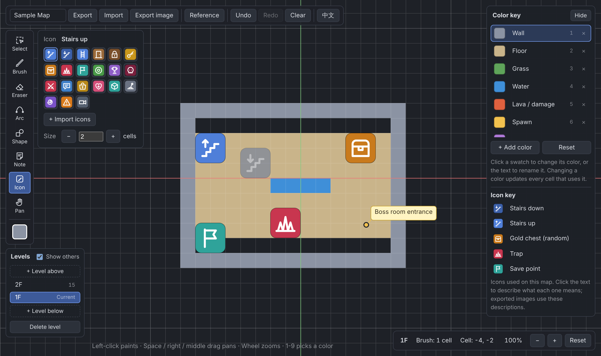
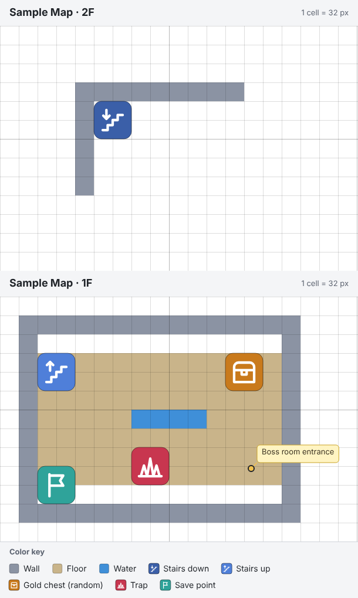

# Level Layout Designer

[中文](README.md) | **English**

A layout drawing tool for game level design. It helps level designers sketch, iterate on and share top-down level layouts quickly.

## Goals

- Sketch level layouts fast: areas, paths, obstacles, spawn points, goals and more
- Make changes and iterate on level ideas easily
- Export and share layouts so the team can discuss them

## Use it online

**Nothing to install. Open the page and start drawing:**

👉 **[Open Level Layout Designer](https://lighting1130.github.io/level-layout-designer/)** (GitHub Pages)



> Anyone can open the GitHub Pages link. Every merge to `main` republishes it automatically; refresh after a few minutes to get the latest version.
>
> The backup claude.ai link is private to the author by default. To let others use it, the author grants access from the **Share** menu at the top right of that page.

The interface opens in Chinese or English depending on your browser language. Switch any time with the **EN / 中文** button at the right end of the top toolbar.

### Use it offline (no network needed)

1. Download [`release/level-layout-designer.html`](release/level-layout-designer.html) from this repository (open the file on GitHub, then click the "Download raw file" button at the top right)
2. Double-click it to open it in Chrome, Edge, Firefox or Safari

It is a single self-contained HTML file with all the code inside. You can send it straight to a colleague, or host it on any static site (GitHub Pages, an intranet server) as your own online copy.

### Five-minute quick start

1. **Name your project**: click "Untitled map" at the top left, type a name and press Enter
2. **Paint terrain**: pick **Brush** (`B`) in the left column, choose a color in the **Color key** on the right (or press `1`-`9`), then click or drag on the canvas to fill cells. Scroll to zoom and hold Space while dragging to pan. Zoom in and the brush automatically paints smaller cells
3. **Draw walls and paths**: **Shape** (`G`) draws rectangles, circles and polygons; **Arc** (`A`) draws curved paths, with optional arrowheads to show direction
4. **Add icons and notes**: **Icon** (`I`) places stairs, chests, traps, save points and more; **Note** (`N`) adds a text note where you click
5. **Add levels**: in the **Levels** panel at the bottom left, click "+ Level above" or "+ Level below"; switch with PageUp / PageDown
6. **Save and share**:
   - Your drawing is saved automatically in this browser, so it is still there when you come back
   - **Export** saves a `.json` project file. Send it to someone and they can **Import** it to keep editing (also the way to move to another computer or browser)
   - **Export image** (`Ctrl+Shift+S`) saves PNGs: one per level (in a ZIP) or all levels in one tall image, with the color and icon key along the bottom



## Features

- Infinite grid: drag to pan, scroll to zoom around the cursor, trackpad pinch and two-finger scroll, two-finger touch zoom
- Endless subdivision: zooming in splits each cell into 10×10 smaller cells, zooming out merges them, and grid levels fade smoothly between each other
- Only the visible area is drawn, so panning far away never slows down
- Origin axes (red X, green Y); the bottom right shows the cursor position (in meters) and the zoom level
- Real-world scale: by default 1 cell = 1 meter; change it in the **1 cell = _ m** field at the bottom right (for example 0.5 or 2). It is saved in the project file. Meter labels run along the axes, and their spacing adapts to the zoom (1, 2, 5, 10, 20, 50 … m, or 50 cm, 10 cm and so on when zoomed in). Brush size, cursor position, the size of the shape being drawn (width × height, length) and the scale on exported images are all shown in meters. Untick **Rulers** to hide the labels
- Brush: click or drag to fill the cell under the cursor. The brush size follows the zoom: it paints whatever cell size you see on screen (10×10 cells when zoomed out, 1/10 or 1/100 of a cell when zoomed in)
- **Color key** panel on the right: 9 default colors named after level elements (wall, floor, grass, water, lava, spawn, goal, enemy, item). Click to pick; edit any color or name directly, add, delete or reset to defaults. Changing a color updates every cell that uses it
- Arc tool: press to set the start, drag to the end and release (or click start then end), then move the mouse to set the bend and click to confirm (Esc cancels). Arcs and lines can have an arrowhead at the end, the start or both
- Shapes: line, rectangle, circle/ellipse, triangle, diamond, hexagon, and regular polygons with 3–64 sides. Outline by default, with an optional **Fill**; hold Shift for squares, circles and regular shapes. Endpoints snap to cell centers, shapes are rasterized at the current brush cell size, and each shape is one undo step
- Arcs and shapes have two modes: **Cells** fills cell by cell; **Smooth** draws vector lines that stay crisp at any zoom and snap to grid intersections. Stroke width is set separately (1–99 cells in cell mode, down to 0.1 cell in smooth mode; toolbar **Width** or `[` `]`). The eraser removes a whole smooth shape at once
- Select (`V`): drag a box to select cells and smooth shapes on the current level, drag inside it to move (snapped to the grid), drag the corner or edge handles to resize it (snapped to the grid; hold Shift on a corner to keep proportions; cells are resampled, shapes, icons and notes scale with it), nudge with arrow keys (Shift for 10 cells), click a color (or press `1`-`9`) to recolor the selection, press `R` (or ↻ 90° in the panel) to rotate it 90° clockwise and `Shift+R` counterclockwise (icons and note text stay upright, and four turns bring it back exactly), `Delete` to remove, `Esc` to cancel, `Ctrl+A` to select the whole level. Moves and deletes are undoable
- Notes (`N`): click empty canvas to add a text note, click a note to edit it. Drag the label or the pin separately and the leader line stretches to follow (this also works with the Select tool; a selected note moves as a whole). Double-click a note with any tool to edit. Notes belong to a level, notes on other levels are faded, and they can be selected, moved, deleted and undone
- Icons (`I`): 21 level icons, including stairs up/down, ladder, door, locked door, key, chest, trap, save point, spawn, goal, boss, enemy, NPC, shop, heal, item, switch, teleporter, hazard and camera. Pick one and click to place it, sized in cells. **+ Import icons** turns your own images (PNG / SVG / JPG / WebP) into icons that you can rename or remove. Icons belong to a level and can be selected, moved, deleted and erased
- Reference images: **Reference** in the top bar imports an image (you can also drop an image onto the canvas or paste a screenshot with Ctrl+V) to trace over beneath the grid. With the Select tool, drag to move, drag a corner to resize proportionally (hold Shift for free resizing), drag an edge to stretch one side, and drag the dot above the image to rotate it (hold Shift for 15° steps), or type an angle or use ↺ / ↻ in the panel to turn 90° (`R` works too); the panel sets opacity, lock, bring to front and delete. Locked images let clicks pass through; double-click with the Select tool to select one again. Reference images belong to a level and can be included in exports
- Generate a layout from a reference image: select the image and click **Generate layout from this image…** in its panel. There are three methods. **Smart detect** (the default) works out the terrain from what the colors mean: black or dark gray lines and gray blocks are walls, blue and cyan are water, green is grass, bright red and orange are lava / damage, and beige, brown, light gray and the like are floor, while white background is skipped. Thin wall lines are still caught, and holes left by text and small icons are filled in. Each terrain uses the color-key entry of the same kind (walls, water and damage by engine type, grass by name); missing entries are added automatically, and you can untick any terrain. **Match colors** turns each cell into the closest color-key color (good for colored plans; black or dark gray lines can count as walls, and white background is skipped). **Line art** fills dark areas with one color (good for black-and-white drawings and scans). Choose the cell size (shown in meters), tolerance or darkness, which colors to use, and whether to remove specks. The canvas shows a preview first; click **Generate** to apply it as one undoable step. Everything runs in the browser and the image is never uploaded
- Levels: 1F, 2F, B1 and so on. Add above or below, switch and delete in the **Levels** panel at the bottom left (PageUp / PageDown to switch). The current level is fully opaque and each level further away is fainter (40%, 16%, …); turn off **Show others** to hide them. Undo jumps to the level that changed
- Eraser, undo/redo, and Clear (current level only); everything is saved automatically in the browser
- Export image (`Ctrl+Shift+S`): current level only, one image per level (in a ZIP), or all levels in one tall image. Options: crop to content or the current view, resolution (8–64 pixels per cell), light or dark background, and whether to include grid lines, notes and reference images. Levels can share the same area so the images line up. Each image has the project and level name at the top and the color and icon key along the bottom; empty levels are skipped, and very large images are scaled down automatically
- Icon key: under the Color key, the icons used in the map are listed, and their text can be changed to say what each one means (for example "Chest" to "Gold chest (random)"). Exported images use these descriptions
- Export / import project files (`.json`, with all levels, notes, color key, project name and view). See [docs/project-file-format.md](docs/project-file-format.md) for the format (in Chinese)
- Ready for game engine import (project file version 5): under each color key entry, pick what it becomes in the engine (**Wall / Floor / Water / Hazard / Marker (no geometry) / Ignore**); walls can have their own height (for example a 1.2 m low wall). The bottom of the Levels panel sets the current level's elevation and wall height (empty = defaults: 5 m per level, 4 m walls). Spawn, camera, door, stairs and similar icons show a small arrow for their facing, which turns when you rotate a selection with R. The UE import prototype is in [engine/unreal/prototype](engine/unreal/prototype) (in Chinese)
- Panning is separate from painting: hold Space and drag, drag with the right or middle mouse button, or switch to the **Pan** tool; two-finger pan and zoom on touch screens
- Chinese / English switch: the **EN / 中文** button at the right end of the top toolbar switches the interface, tips, default color and icon names, level names and exported images. Your choice is remembered
- Shortcuts: `B` brush, `E` eraser, `A` arc, `G` shape, `I` icon, `H` pan, `1`-`9` pick a color, `Ctrl+Z` undo, `Ctrl+Shift+Z` redo, `Ctrl+S` export, `Ctrl+O` import, `0` reset view, `+` / `-` zoom

## Layout

- Left column: Select, Brush, Eraser, Arc, Shape, Note, Icon, Pan and the current color. Choosing Arc or Shape opens options next to it for shape type, fill, cell/smooth mode and width
- Top bar: project name, Export, Import, Export image, Reference, Undo, Redo, Clear, and the language switch
- Right: Color key and Icon key; bottom right: brush size, cell coordinates, zoom

## Local development

Requires Node.js 18+.

```bash
npm install
npm run dev            # open the address shown in the terminal (default http://localhost:5173)
npm run build          # type check + production build into dist/
npm run build:single   # also bundle into one file: release/level-layout-designer.html
```

After changing the code, run `npm run build:single` and commit the new `release/level-layout-designer.html` to update the offline version. GitHub Pages updates automatically after a merge to `main` (the claude.ai link is republished separately).

## Tech stack

Vite + TypeScript. Rendering uses plain Canvas 2D and draws only the grid lines in view. The camera (world ↔ screen coordinates) is in `src/camera.ts`, grid drawing in `src/grid.ts`, painted cell data and drawing in `src/cells.ts`, and the interface text and translations in `src/i18n.ts`.

## License

[MIT License](LICENSE).
