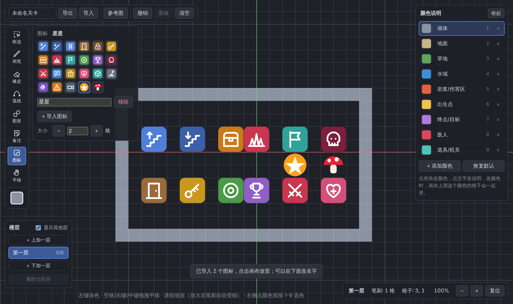
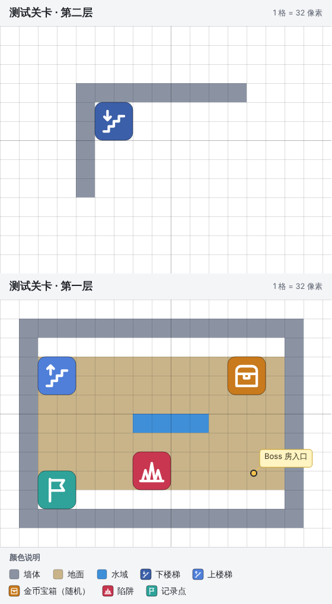
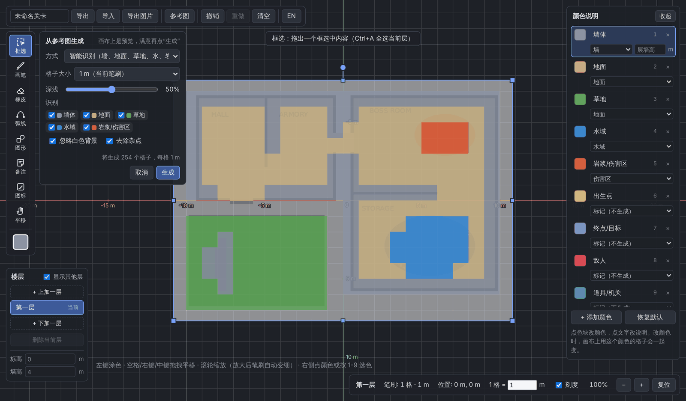
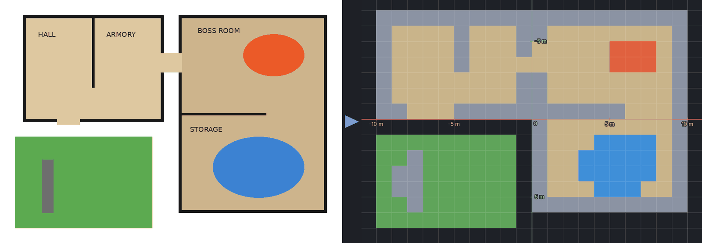
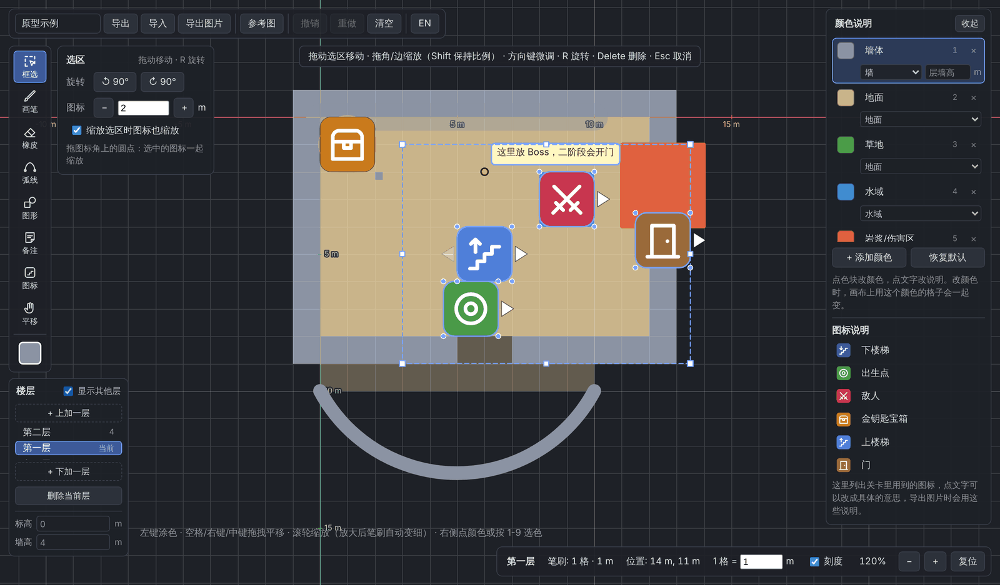
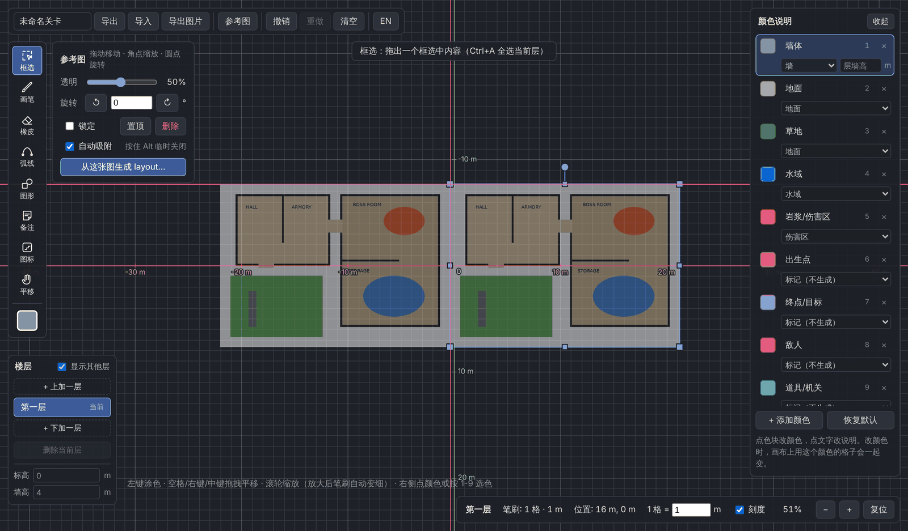
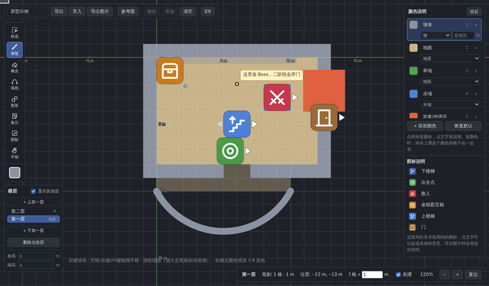
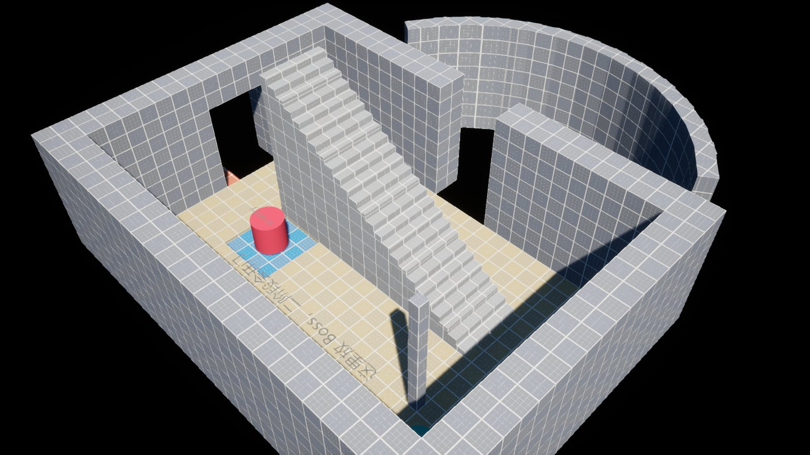
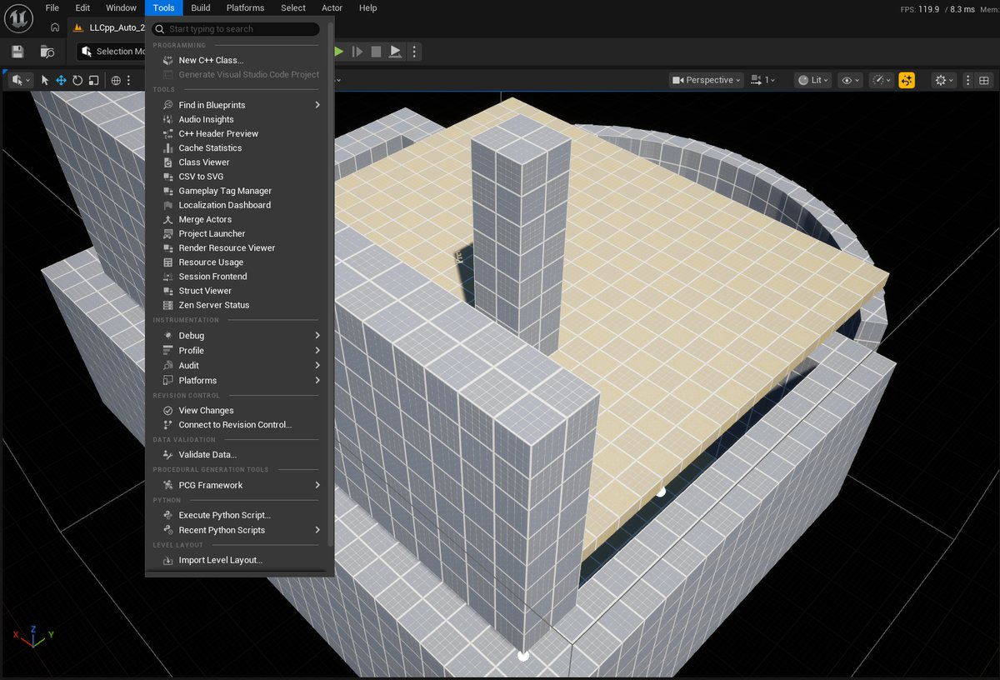
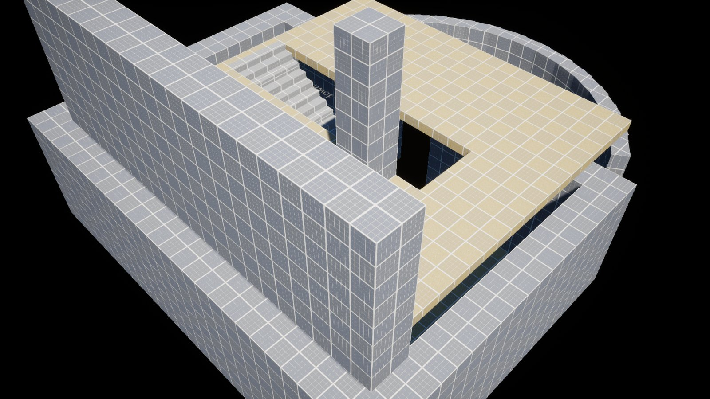

# Level Layout Designer · 关卡设计 Layout 画图工具

**中文** | [English](README.en.md)

一个用于游戏关卡设计的 layout（布局）画图工具，帮助关卡策划快速绘制、迭代和分享关卡平面布局图。

## 项目目标

- 快速绘制关卡的平面布局（区域、路径、障碍、出生点、目标点等）
- 方便地修改和迭代关卡方案
- 导出与分享关卡布局图，便于团队沟通
- 导入 Unreal Engine，一键生成同比例的白盒（见[导入 Unreal Engine](#导入-unreal-engine一键生成白盒)）

## 在线使用

**不用安装任何东西，打开网页就能画：**

👉 **[打开关卡 Layout 设计器](https://lighting1130.github.io/level-layout-designer/)**（GitHub Pages）




> GitHub Pages 的链接任何人都能直接打开。每次有新代码合并到 main，GitHub 会自动重新发布，几分钟后刷新网页就是最新版。
>
> 备用的 claude.ai 链接默认只有作者本人能打开，要给别人用需要在网页右上角的「Share / 分享」菜单里开放权限。

### 离线使用（不需要网络）

1. 下载仓库里的 [`release/level-layout-designer.html`](release/level-layout-designer.html)（在 GitHub 上点开这个文件，再点右上角的 “Download raw file” 下载按钮）
2. 双击这个文件，用 Chrome、Edge、Firefox 或 Safari 打开就能用

这是一个独立的 HTML 文件，所有代码都在里面，可以直接发给同事，也可以放到任何静态网站上（例如 GitHub Pages、公司内网）当作在线版本。

### 五分钟上手

1. **改工程名**：点左上角的“未命名关卡”，输入名字后回车
2. **画地形**：左侧选「画笔」（`B`），在右侧“颜色说明”里选颜色（或按 `1`-`9`），在画布上点击或拖动涂格子。滚轮缩放，按住空格拖动平移；放大后笔刷会自动变细，可以画更小的格子
3. **画墙和路线**：「图形」（`G`）画矩形、圆、多边形，「弧线」（`A`）画弯曲的路线，可以加箭头表示方向
4. **放图标、写备注**：「图标」（`I`）放楼梯、宝箱、陷阱、记录点等；「备注」（`N`）点击画布写说明文字
5. **加楼层**：左下角「楼层」面板点“+ 上加一层”或“+ 下加一层”，PageUp / PageDown 切换
6. **保存和分享**：
   - 画的内容会自动保存在当前浏览器里，关掉网页再打开还在
   - 点顶部「导出」得到 `.json` 工程文件，发给别人后对方点「导入」就能继续编辑（换电脑、换浏览器也用这个方法）
   - 点「导出图片」（`Ctrl+Shift+S`）得到 PNG 图片，可以每层单独一张（打包成 ZIP）或拼成一张长图，底部自动带颜色和图标说明



> 想用英文界面？点顶部工具栏最右边的「EN」按钮。

## 功能截图

**从参考图生成 layout**：导入一张平面图，点「从这张图生成 layout…」，智能识别会按颜色判断墙、地面、草地、水域和岩浆，先在画布上预览，满意后一键生成。





**框选缩放**：拖选区框的四角、四边缩放，格子、图形、图标和备注一起变；框选里的每个图标角上有小圆点，可以只缩放图标；面板里能按米输入图标大小，或取消「缩放选区时图标也缩放」。



**参考图自动吸附**：拖动参考图时会吸附到格线和其他参考图的边、中线，粉色参考线提示对齐位置，多张截图可以无缝拼起来。



**现实尺寸**：默认 1 格 = 1 米，坐标轴上标出米数刻度，右下角可以改每格多少米。颜色说明里可以设置每种颜色在引擎里是什么（墙、地面、水域、伤害区……），楼层面板底部设标高和墙高，导入 UE 时直接使用。



## 当前功能

- 无限延伸的方格背景：拖拽平移、滚轮以光标为中心缩放，触控板捏合/双指滑动、触屏双指缩放
- 网格无限细分：放大时每格不断细分为 10×10 小格，缩小时逐级合并，各级网格随缩放平滑淡入淡出
- 只绘制可见区域，平移到任意远处都不会卡
- 原点坐标轴（红色 X 轴、绿色 Y 轴），右下角显示光标所在位置（米）和缩放比例
- 现实尺寸：默认 1 格 = 1 米，可在右下角「1 格 = _ m」里改（比如 0.5、2），会存进工程文件。坐标轴上标出米数刻度，刻度间隔随缩放自动变成 1、2、5、10、20、50……米，放大后会变成 50 cm、10 cm 等；笔刷大小、光标位置、正在画的图形尺寸（宽 × 高、长度）和导出图片的比例都用米显示。不需要刻度时可取消「刻度」
- 画笔：左键点击或拖拽，填满鼠标所在的方格。笔刷格子大小随缩放自动变化：屏幕上看到多大的格子就涂多大（缩小时可一笔涂 10×10 格，放大后可涂 1/10、1/100 格）
- 右侧“颜色说明”面板：默认 9 种按关卡元素命名的颜色（墙体、地面、草地、水域、岩浆、出生点、终点、敌人、道具）。点击选色；颜色和说明文字都可直接修改，可添加、删除、恢复默认。改某个颜色时，画布上用这个颜色的格子会同步变色
- 弧线工具：按下设起点、拖到终点松开（或依次点击起点和终点），再移动鼠标调整弯曲程度，点击确认（Esc 取消）。弧线和直线可以在“箭头”里选择在终点、起点或两端加箭头
- 几何图形：直线、矩形、圆/椭圆、三角形、菱形、六边形，以及可自定边数（3–64）的正多边形，默认只画线条，可勾选“填充”；按住 Shift 画正方形/正圆/正多边形。起点和终点吸附到格子中心，按当前笔刷格子逐格生成，一次可撤销
- 弧线和图形有两种模式：“格子”逐格填色；“平滑”画矢量线条，任意缩放都顺滑，吸附到网格交点。粗细单独设置（格子模式 1–99 格，平滑模式可细到 0.1 格；工具栏“粗细”或 `[` `]` 键）。橡皮碰到平滑图形会整条删除
- 框选（`V`）：拖出一个框选中当前楼层的格子和平滑图形，在选区内拖动即可移动（对齐格子），拖选区框的四角或四边缩放（对齐格子，拖角时按住 Shift 保持比例；格子会按新大小重新铺满，图形、图标、备注一起缩放），方向键微调（Shift 每次 10 格），点右侧颜色（或按 `1`-`9`）把选中内容换成那个颜色，按 `R`（或面板里的 ↻ 90°）顺时针旋转 90°、`Shift+R` 逆时针旋转（图标和备注文字保持正向，连续旋转四次回到原位），`Delete` 删除，`Esc` 取消，`Ctrl+A` 全选当前层；移动和删除都可撤销
- 备注（`N`）：点击画布空白处添加文字备注，点已有备注可编辑，拖动便签或拖动钉子圆点可以分别移动，另一端不动、连线自动伸缩（框选工具下也能直接拖；框选后拖动则整条备注一起移动）；任何工具下双击备注也能编辑。备注按楼层保存，其他层的备注会变淡；框选可一起移动/删除，可撤销
- 图标（`I`）：上下楼梯、梯子、门、锁着的门、钥匙、宝箱、陷阱、记录点、出生点、终点、Boss、敌人、NPC、商店、回复、道具、机关、传送点、危险、镜头等 21 个关卡图标，选好后点击画布放置，大小按格子设置（旁边显示对应的米数，`[` `]` 快速调整）。也可以「+ 导入图标」用自己的图片（PNG / SVG / JPG / WebP）做图标，可改名、移除。图标按楼层保存，橡皮可擦。框选工具下直接点图标就能选中并拖动；选中后拖角等比缩放，或在面板「图标」一栏输入边长（米）、点 − / +、按 `[` `]` 调整（多个图标各自以中心缩放，可撤销）。框选里同时有格子、图形和图标时，每个图标角上有小圆点，拖一个就能只缩放选中的图标；面板里的「缩放选区时图标也缩放」取消勾选后，拖选区框缩放只移动图标位置、不改图标大小
- 参考图：顶部「参考图」按钮导入图片（也可以把图片直接拖进画布，或 Ctrl+V 粘贴截图），垫在格子下面对照着画。框选工具下拖动图片移动、拖四角等比缩放（按住 Shift 自由缩放）、拖四边单向拉伸、拖图片上方的圆点旋转（按住 Shift 每次 15°）。拖动和缩放时会自动吸附到格线以及其他参考图的边和中线，并显示粉色参考线；旋转靠近 0°/90°/180°/270° 时自动转正；面板里可关闭「自动吸附」，按住 Alt 临时不吸附。也可以在面板里输入角度或点 ↺ / ↻ 转 90°（`R` 键同样可用），面板里调透明度、锁定、置顶、删除；锁定后点击会穿透图片，框选工具双击图片可重新选中。参考图按楼层保存，也会一起导出
- 从参考图生成 layout：选中参考图后点面板里的「从这张图生成 layout…」。三种方式：「智能识别」（默认）按颜色的含义判断地形：黑色/深灰线条和灰色块是墙，蓝色、青色是水域，绿色是草地，鲜艳的红色、橙色是岩浆/伤害区，米色、棕色、浅灰等是地面，白色背景跳过；墙线很细也能识别，文字和小图标留下的空洞会自动补上；结果对应到颜色说明里同类型的颜色（墙、水、伤害区按引擎类型找，草地按名字找），颜色说明里没有的会自动添加，也可以取消勾选某种地形；「按颜色匹配」把每格换成颜色说明里最接近的颜色（适合彩色平面图，黑色/深灰线条可直接算作墙，白色背景自动跳过）；「线稿」把深色的地方涂成一种颜色（适合黑白线稿、扫描图）。可选格子大小（按米显示）、容差或深浅、用哪些颜色、去除杂点；画布上先显示预览，满意后点「生成」，一步可撤销。全部在浏览器里完成，图片不会上传
- 楼层：第一层、第二层、负一层……可在左下角“楼层”面板上下加层、切换、删除（PageUp / PageDown 切换）。当前层 100% 不透明，其他层每远一层透明度更高（40%、16%……），可关闭“显示其他层”。撤销会自动切到改动所在的楼层
- 橡皮擦、撤销/重做、清空（只清空当前层）；绘制内容自动保存在浏览器本地
- 导出图片（`Ctrl+Shift+S`）：只导出当前层、每层单独一张（打包成 ZIP），或所有楼层拼成一张长图。可选自动裁剪到内容或当前屏幕范围、清晰度（每格 8–64 像素）、浅色/深色背景、是否带网格线/备注/参考图；各层可对齐同一范围，方便叠图对照。每张图顶部有工程名和楼层名，底部横排颜色说明和图标说明，空楼层自动跳过，图太大时自动降低清晰度
- 图标说明：右侧“颜色说明”下面会列出关卡里用到的图标，文字可以改成具体含义（比如“宝箱”改成“金币宝箱（随机）”），导出图片时使用
- 导出 / 导入工程文件（`.json`，包含所有楼层、备注、颜色说明、工程名和视角），格式见 [docs/project-file-format.md](docs/project-file-format.md)
- 为导入游戏引擎做准备（工程文件 version 5）：颜色说明每一项下面可以选它在引擎里是「墙 / 地面 / 水域 / 伤害区 / 标记（不生成）/ 忽略」，墙还可以单独设高度（比如矮墙 1.2 m）；楼层面板底部可以设当前层的标高和墙高（留空用默认：层高 5 m、墙高 4 m）；出生点、镜头、门、楼梯等图标外侧有一个小箭头表示朝向，框选后按 R 旋转时朝向跟着转。导入 UE 的方法见下面的[导入 Unreal Engine](#导入-unreal-engine一键生成白盒)
- 平移与涂色分开：按住空格拖拽、右键/中键拖拽，或切换到“平移”工具；触屏双指平移缩放
- 中英文切换：顶部工具栏最右边的「EN / 中文」按钮，界面、提示、默认颜色名、图标名、楼层名（英文为 1F、2F、B1）和导出的图片都会跟着切换，选择会记住
- 快捷键：`B` 画笔、`E` 橡皮、`A` 弧线、`G` 图形、`I` 图标、`H` 平移、`1`-`9` 选色、`Ctrl+Z` 撤销、`Ctrl+Shift+Z` 重做、`Ctrl+S` 导出、`Ctrl+O` 导入、`0` 复位、`+` / `-` 缩放

## 导入 Unreal Engine：一键生成白盒

仓库里带了一个 UE 5.8 编辑器插件 [Level Layout Importer](engine/unreal/LevelLayoutImporter)，把网页导出的 `.json` 工程文件一次性生成成**同比例的白盒**：墙、地面、水域、伤害区、门洞、楼梯、出生点、镜头、备注文字和 NavMesh 范围都会自动摆好，适合第三人称动作 RPG 的尺寸（默认墙高 4 m、层高 5 m、门 2 × 3 m）。在 UE 5.8.4 里编译和测试过。



### 1. 在网页里准备

1. 在右侧「颜色说明」里，给每种颜色选它在引擎里是什么：**墙 / 地面 / 水域 / 伤害区 / 标记（不生成）/ 忽略**。墙可以单独填高度（比如矮墙 1.2 m），留空用楼层墙高。
2. 在左下「楼层」面板底部设每层的**标高**和**墙高**（留空用默认：层高 5 m、墙高 4 m）。
3. 门、锁着的门图标要放在墙上（会开门洞）；上楼梯、下楼梯图标放在楼梯中间，图标外侧的小箭头是朝向（框选后按 `R` 转），楼梯会朝箭头方向往上走。注意 5 m 层高的楼梯有 7.5 m 长，画的时候留出位置。
4. 点顶部「导出」，得到 `.json` 工程文件。

### 2. 安装插件

1. 把仓库里的 `engine/unreal/LevelLayoutImporter` 整个文件夹复制到你的 UE 项目的 `Plugins/` 文件夹下（没有就新建）。
2. 需要能编译 C++：装 Visual Studio 2022（勾选“使用 C++ 的游戏开发”）。纯蓝图项目第一次打开时 UE 会提示编译插件，选“是”。
3. 打开项目，在 **Edit → Plugins** 里确认 **Level Layout Importer** 已启用。

### 3. 导入

打开要放白盒的关卡，点菜单 **Tools → Level Layout → Import Level Layout...**，选工程文件，在对话框里调整选项后点 **Import**。整次导入是一个撤销步骤，`Ctrl+Z` 一下全部撤掉；再次导入同一个工程会替换上次生成的结果。



也可以在 Output Log 的 Cmd 里输入命令（路径里不要有空格）：

```
LevelLayout.Import D:/Levels/第一关.json
LevelLayout.Remove 第一关
```

### 会生成什么

| 网页里 | UE 里 |
| --- | --- |
| 角色为“墙”的格子和线条 | 墙（相邻格子合并成大块，每块一个盒子） |
| “地面” | 楼板，顶面在本层标高 |
| “水域”“伤害区” | 略低的薄板 + 水的 PhysicsVolume / 伤害的 PainCausingVolume |
| 填充的圆、三角形、多边形 | 按形状挤出的 Static Mesh |
| 门图标 | 在墙上开 2 × 3 m 门洞 |
| 上楼梯 / 下楼梯图标 | 通往上一层 / 下一层的直跑楼梯，上一层地面自动开楼梯井 |
| 出生点 / 镜头图标 | PlayerStart / CameraActor |
| 其它图标 | 带名字的小圆柱，也可以在项目设置里换成你自己的蓝图（比如敌人刷新点、宝箱） |
| 备注 | 平放的文字（中文会自动用系统字体生成字体资产） |



如果项目里启用了 Fab 上的 **Blockout Tools** 插件，墙和地面会自动用它的 Blockout Box（带网格材质），否则用引擎自带的 Cube。默认值在 **Project Settings → Plugins → Level Layout Importer** 里改。

更多选项、Python / 蓝图接口和测试方法见插件说明 [engine/unreal/LevelLayoutImporter/README.md](engine/unreal/LevelLayoutImporter/README.md)。不想编译 C++ 的话，也可以用 [Python 原型](engine/unreal/prototype)（功能少一些：不开门洞、不建楼梯）。可以先拿示例工程 [SampleProject.json](engine/unreal/LevelLayoutImporter/Resources/SampleProject.json) 试一下。

## 界面

- 左侧竖排：框选、画笔、橡皮、弧线、图形、备注、图标、平移工具和当前颜色；选弧线或图形时旁边弹出图形类型、填充、格子/平滑模式和粗细
- 顶部：工程名、导出、导入、导出图片、参考图、撤销、重做、清空、中英文切换
- 右侧：颜色说明；右下角：笔刷大小、格子坐标、缩放

## 本地开发

需要 Node.js 18+。

```bash
npm install
npm run dev      # 打开终端里提示的地址（默认 http://localhost:5173）
npm run build    # 类型检查 + 生产构建到 dist/
npm run build:single   # 再打包成一个独立文件 release/level-layout-designer.html
```

改完代码后运行 `npm run build:single`，把新的 `release/level-layout-designer.html` 一起提交，离线版就会更新；合并到 main 后 GitHub Pages 会自动更新（claude.ai 链接需要另外重新发布）。

## 技术栈

Vite + TypeScript，网格用原生 Canvas 2D 只绘制可见区域内的线。相机（世界坐标 ↔ 屏幕坐标）在 `src/camera.ts`，网格绘制在 `src/grid.ts`，涂色格子数据与绘制在 `src/cells.ts`。UE 插件和 Python 原型在 `engine/unreal/`。

## 许可证

本项目采用 [MIT License](LICENSE)。
